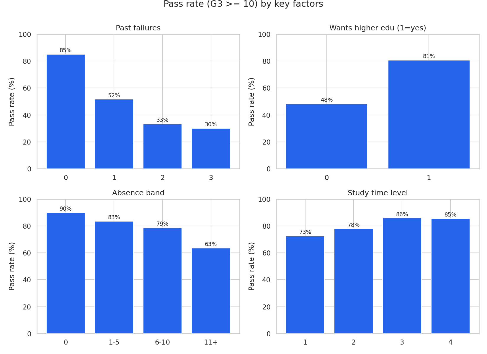
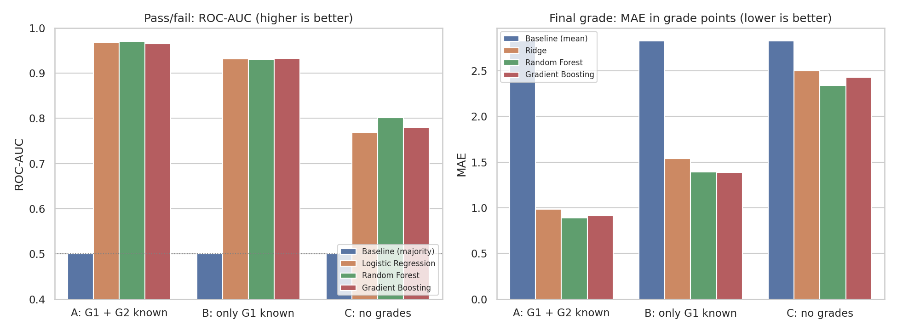

# Student Performance & Attendance Analytics

An end-to-end data analytics project on real secondary-school data: cleaning, SQL analysis, statistical testing, predictive modelling and dashboards. It asks which attendance, study and background factors are linked to student grades, and whether students at risk of failing can be flagged early.



## Dataset

[UCI Student Performance](https://archive.ics.uci.edu/dataset/320/student+performance) (Cortez & Silva, 2008): real school reports and questionnaires from two Portuguese secondary schools. 1,044 subject records (395 Maths, 649 Portuguese), 33 attributes including absences, three period grades (G1, G2, G3), study time, past failures and family background. Licensed CC BY 4.0. The original files are in `data/raw/` and are never modified.

> P. Cortez and A. Silva. *Using Data Mining to Predict Secondary School Student Performance.* In Proceedings of FUBUTEC 2008, pp. 5-12, Porto, Portugal, April 2008, EUROSIS.

## Key findings

Note: each row is one student-subject record, so the 1,044 records are not 1,044 different people. Some students appear in both subject files and the data has no student ID.

- **Past failures are the strongest warning sign:** the pass rate is 85.0% with none, 51.7% with one and 30.0% with three.
- **Absences matter modestly:** the pass rate falls from 89.9% (no absences) to 63.5% (11 or more).
- **Wanting higher education** goes with an 80.7% pass rate against 48.3% for those who do not.
- **Internet access** is linked to higher grades only for urban students (a lead to test, not a proven effect).
- **Early warning works:** a model using only the first-period grade plus background factors reaches ROC-AUC 0.93. Students it marks High risk fail about 72% of the time, against 5% for Low risk (validated with folds that keep a student's two subject rows together).
- **Data quality catch:** 53 records with a final grade of 0 all have 0 absences, which hides the attendance effect unless they are excluded. They are labelled possible dropouts, not confirmed ones.

Full write-up with tables and limitations: [`reports/insights_report.md`](reports/insights_report.md).

## Project phases

| Phase | What | Script / output |
|---|---|---|
| 1 | Problem definition and data dictionary | `docs/phase1_problem_and_data_dictionary.md` |
| 2 | Load, quality checks, cleaning, feature engineering | `src/phase2_load_and_clean.py` |
| 3 | SQLite database, views and 12 analysis queries | `src/phase3_build_database.py`, `sql/` |
| 4 | EDA charts and statistical tests | `src/phase4_eda_and_stats.py` |
| 5 | Predictive modelling and risk scores | `src/phase5_modelling.py` |
| 6 | Excel dashboard and Power BI guide | `src/phase6_build_excel.py`, `powerbi/` |
| 7 | Insights report and documentation | `reports/insights_report.md` |

## Repository structure

```
data/raw/            original UCI files (unchanged)
data/processed/      cleaned data, risk scores, Power BI table
src/                 one script per phase
sql/                 schema and analysis queries
reports/             insights report, stats and model results, charts
excel/               formula-driven Excel dashboard
powerbi/             DAX measures, theme, build guide
models/              saved early-warning model
docs/                problem definition and data dictionary
run_all.py / .sh     run phases 2 to 6 in order
```

## How to run

```bash
python -m venv .venv
source .venv/bin/activate          # Windows PowerShell: .venv\Scripts\Activate.ps1
pip install -r requirements.txt
python run_all.py                  # works on Windows, macOS and Linux
# or: bash run_all.sh (Git Bash / WSL / macOS / Linux), or run the scripts in src/ one by one
```

If you run the scripts in `src/` individually, run them from the repository root, because paths are relative. `run_all.py` handles this for you. The SQLite file `student_analytics.db` is rebuilt by phase 3 and is not tracked in git.

## Methods in brief

- **Cleaning (Pandas, NumPy):** quality checks, flagging (not deleting) suspicious records, derived features such as `pass_flag`, `absence_band` and `grade_change`.
- **SQL:** joins, CTEs, window functions, a view for at-risk students, and an approximate one-to-one cross-subject student match (358 pairs; the key is not guaranteed unique).
- **Statistics (SciPy):** Welch t-test, Spearman correlation, Kruskal-Wallis, chi-square with Cramér's V, Mann-Whitney, with Holm correction for multiple tests.
- **Modelling (scikit-learn):** logistic regression, random forest and gradient boosting against a baseline, cross-validated in three scenarios (all grades, first-period grade only, no grades). Folds are grouped by background attributes so the same student's Maths and Portuguese rows stay together. Permutation importance and out-of-fold risk scores.
- **Dashboards:** an Excel workbook where every figure is a live formula on the data sheet, plus Power BI measures and a four-page build guide.



## Limitations

Associations, not causes. Data come from two schools in 2005-2006. Students appear in both subject files and there is no student ID, so cross-subject matching and grouped validation are approximate. The model has not been tested on new data. The Power BI folder holds preparation assets and a build guide; no finished `.pbix` report is included. See the insights report for the full list.

## Tech stack

Python, Pandas, NumPy, SciPy, scikit-learn, Matplotlib, Seaborn, SQL (SQLite), Excel (openpyxl), Power BI.

## Licence and credits

The dataset keeps its own CC BY 4.0 licence and attribution (Cortez & Silva, 2008).
